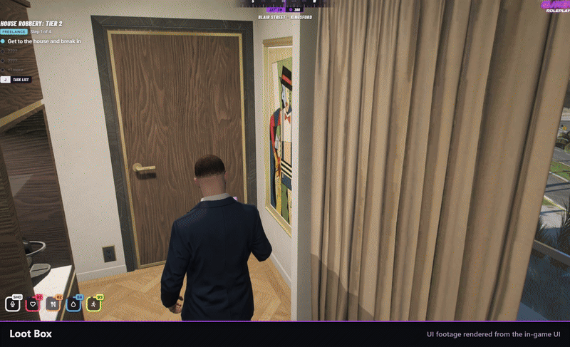

<div align="center">


# glitch-lootBox

### CS2 style case opening for FiveM.

**A player uses a crate, sees what can be inside, then watches the reel spin and land on the reward.**<br>
The server rolls every crate before the reel starts, so what the reel shows is what the player gets. Crates, odds and grades are all in config.

Works with Qbox, QBCore or ESX. Needs ox_inventory.


[Features](#features) &middot; [What you need](#what-you-need) &middot; [Install](#install) &middot; [Configuration](#configuration) &middot; [Adding a crate](#adding-a-crate) &middot; [Exports](#exports) &middot; [How it works](#how-it-works) &middot; [Troubleshooting](#troubleshooting)



</div>

---

Use it for ammo crates, heist loot, event rewards or anything else that should feel good to open.

## Features

| | |
|---|---|
| **Unlock screen** | The case, everything it can hold with grade colours and drop odds, any guaranteed extras, and how many the player has. |
| **Reel** | A strip of cards weighted like the real odds spins under a gold marker, ticking on every card, and stops at a random point inside the winning card. |
| **Reveal** | The item with a burst in its grade colour, sparkles from Epic up, the extras, and Open Another if the player has more of the same crate. |
| **Mystery grades** | Grades marked `mystery` show as a gold star card until revealed. |
| **Server authority** | The server takes the crate and rolls the reward. The client only sends back a session token. |
| **No lost loot** | A rolled reward survives a disconnect, a character switch and a server crash. |
| **Locales** | Every player-facing string is in `locales/en.lua`. |

## What you need

Required:

- FiveM server artifact with OneSync
- ox_inventory
- A framework: qbx_core, qb-core or es_extended (used to make crates usable)

Tested with qbx_core 1.24.0 and ox_inventory 2.48.0.

Optional, detected at run time:

- glitch-crafting: crates can hand out crafting blueprints (`blueprint` and `unlock` reward fields). Without it those rewards are left out of the roll.
- glitch-abstraction: used for the inventory only if ox_inventory is not running.
- glitch-criminaltablet: at start the console warns about trading cards in a crate that its pawn counter would not buy. Off by default. Set `config.integrations.pawnCheck = { resource = 'glitch-criminaltablet', category = 'Trading cards' }` to turn it on.
- glitch-cardAlbums: reads the pack odds through the [exports](#exports).

## Install

1. Put the folder `glitch-lootBox` in your resources.
2. Paste the entries from `install/items.lua` into `ox_inventory/data/items.lua` (drop the `return {` and the closing `}`) and restart ox_inventory. Do not give a crate a `client.export` or `server.export`.
3. Open `config/crates.lua`. It ships three crates that hand out stock ox_inventory items (water, bandage, lockpick, cash). Edit or replace them. `config/crates.demo.lua` holds the larger set from the Glitch Studios demo server; load it with `config.server.cratePack = 'demo'` once your inventory has those reward items. Rewards whose item is missing are left out of the roll and logged once at start. ox_lib is also required.
4. Add `ensure glitch-lootBox` to your server.cfg after your framework and ox_inventory.

There is no database table. Pending loot is kept in the resource KVP store.

## Configuration

Shared settings are in `config/main.lua`, crates in `config/crates.lua` (server only) and server settings in `config/server.lua`.

| Option | Default | What it does |
| --- | --- | --- |
| `debug` | `false` | Prints every roll and payout to the server console. |
| `useUI` | `true` | `false` opens crates instantly with a notification. |
| `locale` | `'en'` | A file in `locales/`. |
| `ui.showPreview` | `true` | Shows the Unlock Container screen first. |
| `ui.showChances` | `true` | Shows drop odds on the preview screen. |
| `ui.spinTime` | `6.5` | Seconds the reel spins. |
| `ui.reelLength` | `56` | Cards on the reel. |
| `ui.winnerIndex` | `48` | Card the reel lands on. Keep it at least 4 below `reelLength`. |
| `ui.allowSkip` | `true` | SPACE or ESC skips to the reveal. |
| `ui.volume` | `0.5` | Reel tick volume. `0` mutes it. |
| `ui.blurBackground` | `true` | Blurs the world behind the screen. |
| `ui.inventory.iconPath` | `false` | Image folder. `false` uses the ox_inventory image path. |
| `ui.inventory.iconOverrides` | `{}` | Per-item image urls. |
| `server.revealGrace` | `25` | Seconds past the spin time before the server pays out anyway. |
| `server.throttle` | `0.5 / 0.6` | Seconds between crate requests per player. |
| `server.blockWhenIncapacitated` | `true` | Dead, last stand and cuffed players cannot open crates. |
| `server.pendingDelay` / `pendingTries` | `5` / `10` | How long and how often to retry handing over saved loot after login. |

### Grades

Each grade in `config.rarities` has a `label`, a `color`, an `order` (higher is rarer, 6 and up get sparkles) and a GTA frontend `sound`. Add `mystery = true` to hide that grade behind a gold star card. The defaults are the CS2 grades from Common to Mythic.

## Adding a crate

Add an entry to `config.lootBoxes` in `config/crates.lua`. The key is the crate's item name.

```lua
ammocratet1 = {
    name = 'Ammo Crate T1',
    accent = '#b0c3d9',
    rewards = {
        { item = 'ammo-9',       label = '9mm Ammo',       min = 50, max = 150, rarity = 'common', chance = 60 },
        { item = 'ammo-shotgun', label = 'Shotgun Shells', min = 15, max = 35,  rarity = 'rare',   chance = 30 },
        { item = 'lockpick',     min = 1, max = 3,                              rarity = 'epic',   chance = 10 },
    },
    bonusItems = {
        { item = 'money', amount = { min = 25, max = 100 }, label = 'Cash Find' },
    },
},
```

| Field | What it does |
| --- | --- |
| `rewards` | Exactly one is rolled. `chance` is a weight, so the numbers do not need to add up to 100. |
| `min` / `max` | Amount range for the reward. |
| `bonusItems` | Always given on top. `amount` is a number or `{ min, max }`. |
| `name`, `category`, `description` | Texts on the preview screen. |
| `accent` / `image` | Colour of the drawn case, or an image url to use instead. |
| `label` | Reward label. Falls back to the inventory item label. |
| `blueprint` / `unlock` | glitch-crafting recipe or unlock id. Needs glitch-crafting. |
| `sources` / `weights` | Limit a reward to crates from certain jobs, or scale its chance for them. Crates carry the job in item metadata `source`. |

## Exports

Both are server side.

| Export | Returns |
| --- | --- |
| `GetDropRates()` | Table of item name to best pull chance in percent, from crates without a job source. |
| `GetMysteryItems()` | List of item names that sit behind a `mystery` grade in any crate. |

## How it works

- The crate is taken and the reward is rolled on the server when the player presses Unlock. The client cannot choose or change it.
- The reward goes into the inventory at the reveal, so the inventory popup does not spoil it. A rolled crate pays out exactly once. If the reveal never reports back, the server pays out anyway after the grace time.
- The rolled reward is saved before the spin. If the player disconnects, switches character or the server stops, it is handed over the next time that character loads in.
- Before a crate is taken, the player must have room for every possible reward. Anything that still does not fit is dropped at their feet, or kept for the next login when a drop is not possible.
- Closing the preview costs nothing. A spinning crate can only be skipped.
- Nothing runs on the client while the screen is closed.

## Troubleshooting

| Problem | Fix |
| --- | --- |
| The console says a crate item is not loaded | Add it to ox_inventory (`install/items.lua`), restart ox_inventory, then the resource. |
| A reward never drops | Its item is missing from ox_inventory, or it needs glitch-crafting. Check the warnings at start. |
| "Make some room in your inventory" | The player cannot carry the biggest possible reward. Lower the amounts or the item weight. |
| Item images are blank | Set `ui.inventory.iconPath` to your image folder, or add `iconOverrides`. |
| Using the crate does nothing | The crate item has a `client.export` or `server.export`. Remove it. |

## Credits

- ox_inventory belongs to its authors.
- Barlow and Barlow Condensed are bundled in `html/fonts` under the SIL Open Font License 1.1 (see `html/fonts/OFL.txt`).

## Support

Support is through the Glitch Studios Discord and the Tebex store page where you bought the resource.

## License

Proprietary, see `LICENSE`. Copyright Glitch Studios. You can edit the files marked as open in `fxmanifest.lua` (`escrow_ignore`) for your own use on one server.
